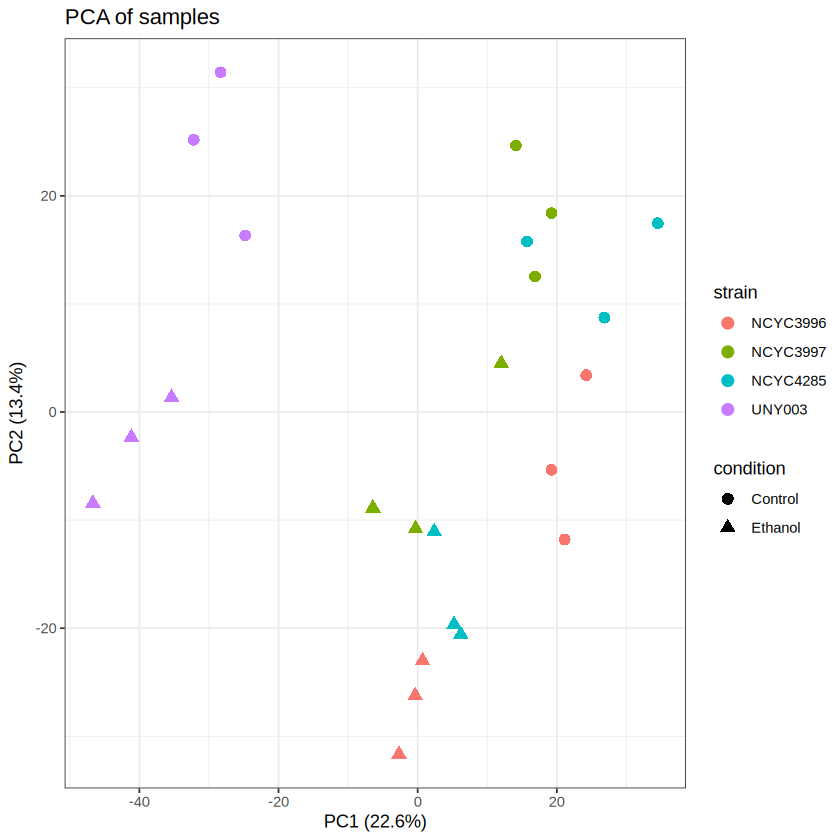
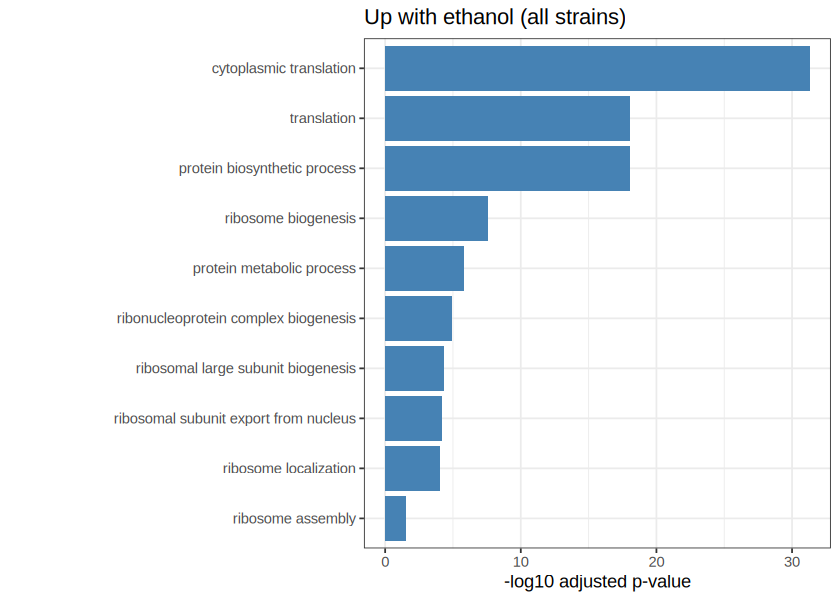
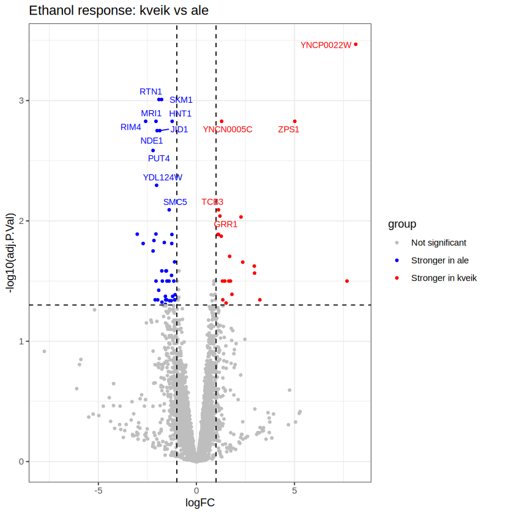
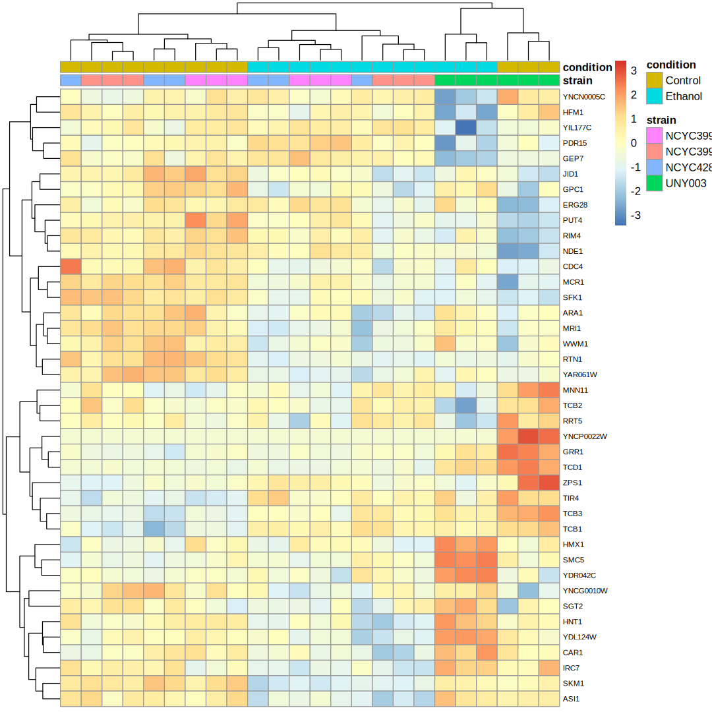
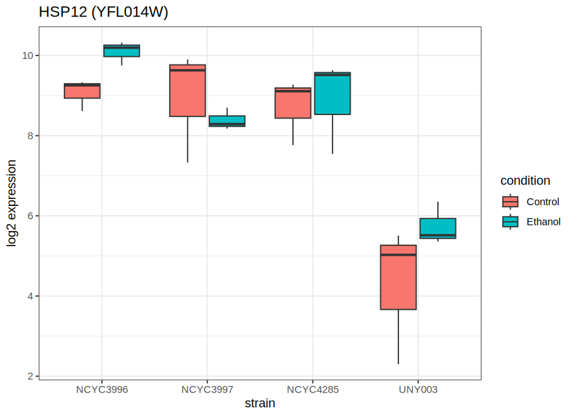
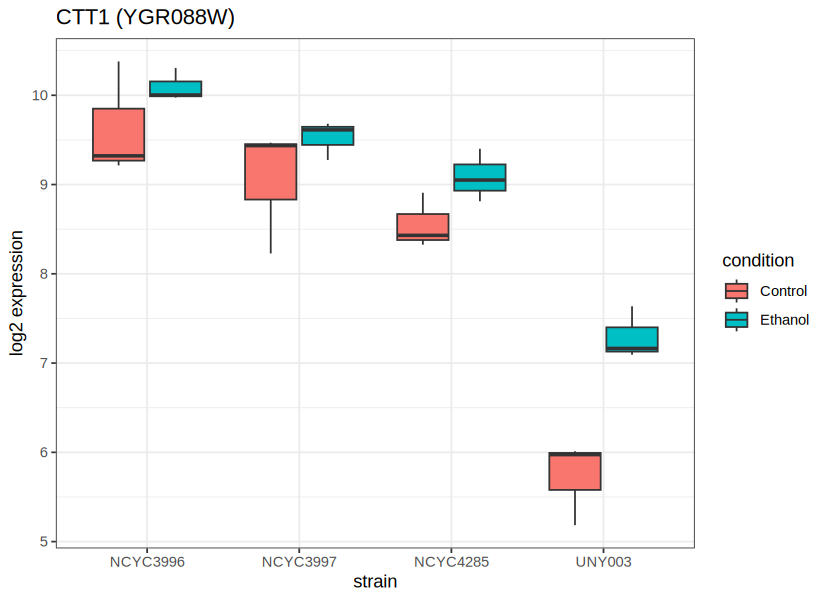

# Ethanol Stress Response in Kveik vs Ale Yeast (RNA-seq)

Kveik are traditional Norwegian farmhouse yeast strains known for their high tolerance to stress, which makes them interesting for industrial fermentation. In this project I compared how three kveik strains and one conventional ale strain respond to **ethanol stress** at the gene expression level.

## Questions
1. Which genes respond to ethanol in all strains?
2. Do kveik strains respond to ethanol differently from the ale strain?
3. Are stress genes like HSP12 and CTT1 already higher in kveik before stress?

## Dataset
- **Source:** GEO [GSE331206](https://www.ncbi.nlm.nih.gov/geo/query/acc.cgi?acc=GSE331206)
- **Strains:** UNY003 (ale), NCYC3996, NCYC3997 and NCYC4285 (kveik)
- **Conditions:** control (30°C) and ethanol, 3 replicates each (24 samples)
- **Input:** normalized counts (raw counts were not available)

## Workflow
1. Data cleaning: removed duplicated genes and added missing gene names using g:Profiler
2. Filtered low expressed genes and log2 transformed the data
3. PCA
4. Differential expression with **limma** (one group per strain and condition, with contrasts)
5. Volcano plot and heatmap
6. GO enrichment with **g:Profiler** (gprofiler2)

## Results

### PCA

PC1 separates the ale strain from the kveik strains, and PC2 separates control from ethanol samples.

### Ethanol response
Each strain changed the expression of several hundred genes after ethanol, but only 37 genes were up and 27 were down in all 4 strains, so a large part of the response is strain-specific.

On average across all strains, 265 genes went up and 331 went down. The upregulated genes were strongly enriched for translation and ribosome biogenesis:

This is the opposite of the classic yeast stress response, where these genes usually go down, and may be related to the experimental conditions.

### Kveik vs ale
22 genes had a stronger ethanol response in kveik and 42 in the ale strain.

### HSP12 and CTT1

Before stress, HSP12 and CTT1 were clearly higher in all three kveik strains than in the ale strain (roughly 16-fold and 8-fold, estimated from the plots). This agrees with the original study and suggests that kveik may be prepared for stress in advance.

## Conclusion
The clearest result is the high basal expression of the stress genes HSP12 and CTT1 in kveik, which may help explain their stress tolerance. The ethanol response itself was largely strain-specific, and the difference between kveik and ale involved a small number of genes without a clear pathway.

**Limitations:**
- Only one ale strain was used, so the results can't be generalized to all kveik and ale yeasts.
- Only normalized counts were available, so I used limma on log-transformed data instead of DESeq2.
- One ethanol concentration and one time point.

The full analysis is in the [notebook](kveik_ethanol_stress.ipynb).

## Tools
R, limma, gprofiler2, ggplot2, ggrepel, pheatmap, Google Colab

## How to run
Open the notebook in Google Colab using the button at the top (with the R runtime) and run all cells.
